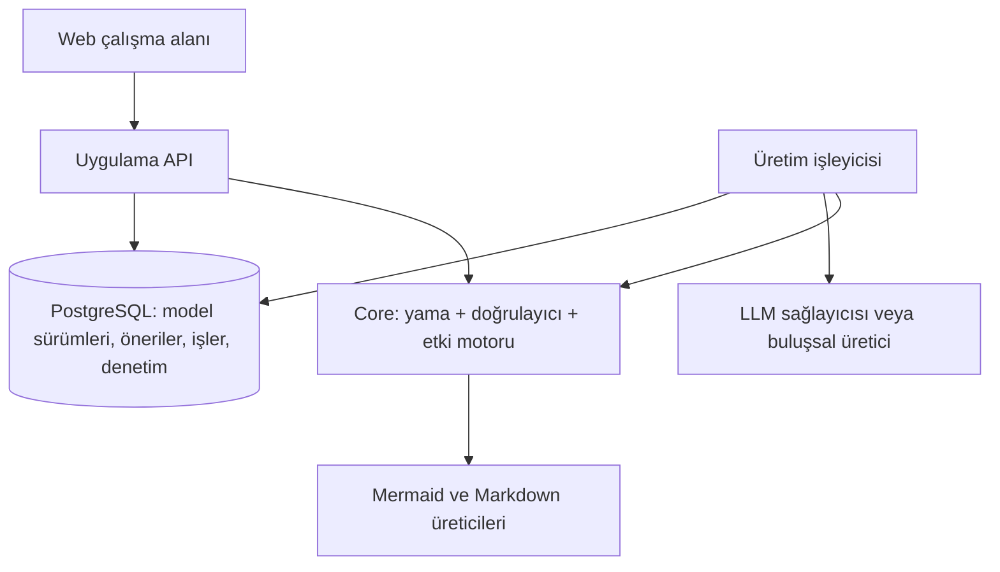
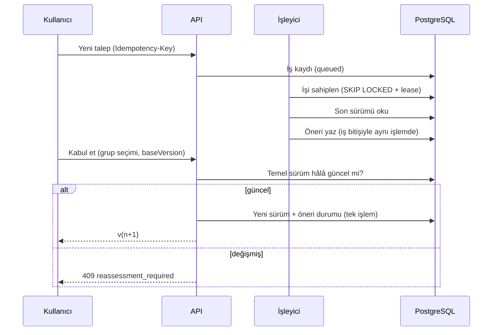

# ARCVORA — Teknik mimari ve tasarım kararları

Bu belge ARCVORA'nın **kendi** mimarisini anlatır (ürün dokümanı §13–§17). Kullanıcı için tasarlanan uygulamalar değildir.

## 1. Genel bakış

Modüler monolit + ayrı çalıştırılabilen üretim işleyicisi. Önbellek ve ayrı mesaj kuyruğu yoktur; dayanıklı iş kayıtları PostgreSQL'dedir.

| Proje | Sorumluluk | Bağımlılık |
|---|---|---|
| `Arcvora.Core` | Model, patch, doğrulama, görünümler, etki, AI hattı. **Saf**: veritabanı, HTTP, saat yok. | yok |
| `Arcvora.Infrastructure` | EF Core/PostgreSQL, erişim, sürüm/kabul, iş kuyruğu, Anthropic istemcisi, kimlik | Core |
| `Arcvora.Api` | HTTP uçları, JWT, hata eşleme, SPA sunumu | Infrastructure |
| `Arcvora.Worker` | `JobWorkerService` ana bilgisayarı | Infrastructure |

İş mantığının çoğunun Core'da saf fonksiyon olması bilinçlidir: kabul, etki ve doğrulama kuralları veritabanı olmadan test edilir.

## 2. Model

`ArchitectureModel` bir **anlık görüntüdür** (JSON); diyagramlar bundan türetilir. Tek doğruluk kaynağıdır (§14.3):

- İndirilen Mermaid dosyasındaki dış düzenlemeler modele aktarılmaz. Ham Mermaid düzenleme kapsam dışıdır.
- Kimlikler `PREFİKS-NNN` biçimindedir (`REQ`, `DEC`, `CMP`, `REL`, `ENT`, `ACT`, `FLW`, `API`, `TRC`, `OQ`, `ASM`, `SRC`; kabul ölçütleri iç içe `AC`). Önek tür ile eşleşmezse şema hatasıdır.
- **`origin` ve `reviewStatus` ayrı alanlardır.** Kullanıcı bir sistem önerisini kabul edince `reviewStatus=confirmed` olur; `origin=system_proposal` kalır.
- İzlenebilirlik tek mekanizmayla yapılır: `TraceLink` (`addresses`, `implements`, `depends_on`, `assumes`, `blocked_by`). Tür uyumluluğu doğrulayıcıda zorlanır (örn. `addresses` yalnızca karar → gereksinim).
- Normalleştirme (listeler kimliğe göre sıralanır) sayesinde aynı içerik aynı SHA-256 özetini üretir.

### Doğrulayıcı

| Tür | Örnek kural | Engelleyici mi? |
|---|---|:-:|
| Şema (`SCH-*`) | yinelenen/yanlış önekli kimlik, boş zorunlu alan, geçersiz HTTP metodu | evet |
| Referans (`REF-*`) | var olmayan bileşene bağlantı, akış katılımcısı, geçersiz izlenebilirlik türü | evet |
| Tutarlılık (`CON-*`) | kendine bağlantı, sahipsiz varlık, alt/else koşulsuz adım | hayır |
| İzlenebilirlik (`TRC-*`) | karara bağlanmamış kritik gereksinim, kabul ölçütü eksik, soruya bağlı karar | hayır |
| Profil (`PRF-*`) | profille çelişen teknoloji (`Spring` + ASP.NET Core) | hayır |
| İnceleme önerisi (`REV-*`) | dış çağrıda hata davranışı yok, ölçülemeyen kalite gereksinimi, idempotency | hayır; **kanıt değildir** |

Bulgu anahtarı `kural|nesne|mesaj`; bir değişikliğin *yeni* bulguları temel modelle karşılaştırılarak bulunur. Önceden var olan sorun yeni değişikliği engellemez, **yeni** engelleyici hata engeller.

## 3. Sürüm, öneri ve kabul

**Tasarım kararı — taslak = öneri.** Sürümler her zaman kabul edilmiş, değişmez anlık görüntülerdir; "taslak" kavramı bir **öneri** (`Proposal`) olarak yaşar. Bu, "kabul edilmiş sürüm sessizce değiştirilmez" ilkesini (§7.7) mimari olarak garanti eder: sürüm tablosunda güncelleme yoktur, yalnızca ekleme.

Eşzamanlılık güvencesi iki katmanlıdır:

1. `ModelVersions (ProjectId, Number)` **benzersiz indeks** — iki yazıcı aynı numarayı yazamaz.
2. `Projects`/`Proposals` üzerinde `xmin` eşzamanlılık belirteci.

Yarışı kaybeden istek `409 version_conflict` alır. Aynı öneriyi aynı anda kabul eden istekler için kaybeden, kazananın sürümünü **idempotent** olarak döndürür.

> Çıkarılan ders (testle yakalandı): `AsNoTracking` bir birleşimin tek kolunda bile olsa **tüm sorguyu** izlemesiz yapar. Erişim servisinin ilk sürümü bu yüzden `Project.HeadNumber` güncellemesini sessizce yazmıyordu. Artık izleme istenen yerde sorgunun hiçbir kolunda `AsNoTracking` yoktur.

### Kısmi kabul

Patch işlemleri **gruplara** ayrılır. Gruplar arası bağımlılık yapısal başvurulardan hesaplanır: bir grup, başka grubun yarattığı nesneye başvuruyorsa ona bağlıdır; bir nesneyi silen grup, o nesneye başvuran mevcut nesneleri değiştiren/silen gruplara bağlıdır. Yalnızca bağımlılık altında kapalı seçimler kabul edilir. Serbest metindeki kimlik anmaları ("OQ-004'te cevap bekliyor") bağımlılık sayılmaz. Uygulama sonrası yeni engelleyici bulgu çıkarsa kabul yine reddedilir.

### Etki motoru

Doğrudan etki, model farkından (eklenen/değişen/silinen) gelir. Bağımlı etki, **yönlü** kenarlar boyunca en çok iki adım yayılır (gereksinim → karar → uygulayan nesne; bileşen → bağlantı/akış/veri/endpoint; soru → bağlı nesne). Bileşen/aktör "merkez" düğümler ikinci adımda genişletilmez; böylece tek bir bileşen yüzünden bütün graf işaretlenmez. Olası etkiler LLM/inceleme girdisidir ve etiketlidir; belirsiz etki cevap bekleyen sorulara bağlıdır.

## 4. AI hattı

`IArchitectureGenerator` (Extract / Architecture / Change / Repair) iki gerçekleştirmeyle gelir:

- `LlmArchitectureGenerator` → `ILlmClient` (şu an `AnthropicLlmClient`, zorunlu `tool_choice`).
- `HeuristicGenerator` → anahtarsız, **AI olmayan**; çıktısı `isAi=false` ve notla işaretlenir.

`ProposalPipeline`: üretim → `DraftResolver` (geçici `new-N` kimlikleri gerçek kimliklere) → `GeneratorGuard` → patch uygulama → doğrulama → (en çok `MaxRepairs` onarım) → etki analizi.

**Güvenlik sınırları** (`GeneratorGuard`; kaynak doküman içindeki talimatlar sistem yetkisini değiştiremez):

- Görev başına izinli nesne türleri; kaynaklara (`Source`) hiçbir üretici dokunamaz; işlem sayısı sınırlı.
- Yeni nesneler her zaman `proposed` (veya `deferred`) olur; `confirmed` iddiası yok sayılır.
- `origin=user_statement` yalnızca alıntı kaynak metinde **bulunursa** korunur, aksi hâlde `system_proposal`'a indirilir.
- Var olan bir nesnenin `origin`/`reviewStatus`'u üretici tarafından değiştirilemez.
- Her turda en çok 3 yeni açık soru (etkiye göre).
- Gömülü kullanıcı metni etiketleri etkisizleştirilir (`<`→`‹`) ve istemde "güvenilmeyen veri" olarak çerçevelenir.
- LLM doğrudan veritabanına, dosyaya veya dış hesaba erişmez; yalnızca önerilen patch döndürür.

Bütçe: token, süre ve onarım sayısı iş başınadır. Süre aşımı `timeout`, bütçe aşımı `budget`, doğrulama başarısızlığı `validate` aşaması olarak işe yazılır; hiçbiri modeli değiştirmez.

## 5. İş kuyruğu

- Claim: tek `UPDATE … WHERE Id = (SELECT … FOR UPDATE SKIP LOCKED LIMIT 1) RETURNING`.
- Lease + kalp atışı (`LeaseSeconds/3`). Worker ölürse lease dolar, iş yeniden alınır; deneme hakkı bittiyse `lease_expired` ile başarısız olur (sonsuz çökme döngüsü yok).
- Geçici hata (`LlmTransientException`, HTTP/IO) → üstel bekleme ile kuyruğa dön; sağlayıcı/doğrulama hatası → kalıcı başarısızlık.
- İptal: kuyruktaki iş doğrudan iptal edilir; çalışan işte bayrak kalp atışıyla görülür, sağlayıcı çağrısı iptal belirteciyle kesilmeye çalışılır ve **sonuç her durumda projeye uygulanmaz**.
- Sonuç (öneri + iş durumu) yalnızca lease hâlâ bu worker'dayken **tek işlemde** yazılır.
- `Idempotency-Key`: `(ProjectId, IdempotencyKey)` benzersiz indeksi; eşzamanlı tekrar gönderim tek iş üretir.

## 6. Güvenlik

- Her proje işlemi çalışma alanı üyeliğini ve rolü sunucuda doğrular; yetkisiz erişimde **404** (varlık sızdırılmaz). İşler (`/jobs/{id}`) de işin ait olduğu projeden doğrulanır.
- Roller: yönetici / düzenleyici / okuyucu; kabul yetkisi düzenleyici için ayrıca kapatılabilir. Çalışma alanında son yönetici kaldırılamaz.
- Parolalar PBKDF2-SHA256 (210k iterasyon); girişte kullanıcı yokken de aynı maliyetli doğrulama yapılır; hata mesajı kullanıcı varlığını sızdırmaz. Kimlik uçlarında IP başına hız sınırı.
- Mermaid `securityLevel: strict`; `click` yönergesi üretilmez. Kullanıcı metni her bağlamda (`%`, `#`, `"`, `<`, `>`, `&`, satır sonu) kaçışlanır; boş etiket kimliğe düşer. Düğüm tıklaması DOM dinleyicisiyle bağlanır. **Gerçek Mermaid ayrıştırıcısıyla düşmanca etiketler üzerinde doğrulandı** (ve `%%{init}%%` kaçışı bu doğrulamada bulunup düzeltildi).
- Markdown çıktısında kullanıcı metnindeki HTML etiketleri etkisizleştirilir, tablo hücrelerinde `|` kaçışlanır.
- API anahtarları istemciye verilmez ve loglanmaz; `Jwt:Key` eksikse API başlamaz.
- Denetim kaydı: proje oluşturma/silme, model düzenleme, kabul/ret, geri dönüş, dışa aktarma, üyelik değişiklikleri. Proje silinse de denetim kayıtları saklanır (FK yok).

## 7. Dışa aktarma

`HandoffRenderer` zaman damgası içermez; aynı model sürümü + aynı üretici sürümü aynı çıktıyı üretir (zip içeriği sabit zaman damgası kullanır). `Artifact` kaydı: model sürümü, model hash'i, profil kimliği/sürümü, üretici sürümü, içerik hash'i. Aynı çıktı tekrar istenirse yeni kayıt açılmaz.

## 8. Bilinçli olarak yapılmayanlar

Önbellek, ayrı mesaj kuyruğu, mikroservis, tam uygulama üretimi, depo analizi, canlı yük/maliyet simülasyonu, ham Mermaid içe aktarma, çok kullanıcılı dal/birleştirme (bkz. ROADMAP "Kapsam dışı").
